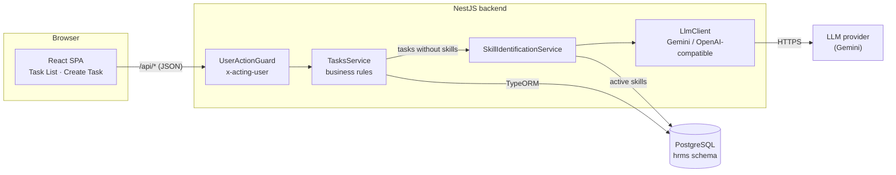
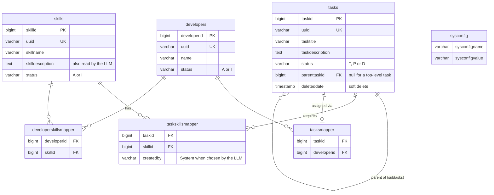

# HTX Task Assignment

A full-stack application for creating tasks (with nested subtasks), identifying the skills each task needs with an LLM, and assigning tasks to developers who have those skills.

| Part | Technology |
|---|---|
| Frontend | React 19 + TypeScript, Vite, MUI, React Router, Redux Toolkit ([`portal/hrms`](portal/hrms/README.md)) |
| Backend | NestJS 12 + TypeScript, TypeORM ([`webapp`](webapp/README.md)) |
| Database | PostgreSQL 18 ([`containers/postgresql`](containers/postgresql/docker-entrypoint-initdb.d)) |
| LLM | Google Gemini by default; any OpenAI-compatible provider through configuration |

---

## Contents

1. [Running the application](#running-the-application)
2. [Configuration](#configuration)
3. [System design](#system-design)
4. [Data model](#data-model)
5. [API](#api)
6. [Business rules](#business-rules)
7. [Skill identification with an LLM](#skill-identification-with-an-llm)
8. [Libraries and why they were chosen](#libraries-and-why-they-were-chosen)
9. [Assumptions](#assumptions)
10. [Testing](#testing)
11. [Repository layout](#repository-layout)

---

## Running the application

### Quick start (Docker)

Open webapp/.env and set LLM_API_KEY to the key from our email.
Then run docker compose up --build and open http://localhost:4000.

### Prerequisites

- Node.js 22 or later
- Docker (for PostgreSQL)
- A Gemini API key (free at https://aistudio.google.com/apikey), or another LLM provider (see [Configuration](#configuration))

### 1. Database

```bash
docker compose up -d postgresql
```

On first start, the scripts in `containers/postgresql/docker-entrypoint-initdb.d` create the roles, the `htxhrms` database, the `hrms` schema and tables, and seed the developers and skills from the brief:

| Developer | Skills |
|---|---|
| Alice | Frontend |
| Bob | Backend |
| Carol | Frontend, Backend |
| Dave | Backend |

### 2. Backend (port 3000)

Create webapp/.env.local with LLM_API_KEY=your-key (the rest of the settings are in the committed webapp/.env).

```bash
cd webapp
npm install
npm run start:dev
```

The log line `Skill identification uses GeminiClient` confirms the LLM is configured.

### 3. Frontend (port 4000)

```bash
cd portal/hrms
npm install
npm run dev
```

Open http://localhost:4000. In development, Vite forwards every `/api/*` request to the backend on port 3000, so the browser only talks to one origin.

---

## Configuration

### Backend (`webapp/.env`)

| Variable | Required | Default | Description |
|---|---|---|---|
| `DB_HOST` | Yes | | e.g. `localhost` |
| `DB_PORT` | Yes | | e.g. `5432` |
| `DB_USER` | Yes | | The application role, `hrms_webapp` |
| `DB_PASSWORD` | Yes | | The password set for `hrms_webapp` in `002_htx_hrms_accounts.sql` |
| `DB_NAME` | Yes | | `htxhrms` |
| `DB_SCHEMA` | Yes | | `hrms` |
| `PORT` | No | `3000` | HTTP port |
| `LLM_PROVIDER` | No | `gemini` | `gemini`, `openai-compatible` or `none` |
| `LLM_API_KEY` | For Gemini and hosted providers | | The provider's API key |
| `LLM_MODEL` | For `openai-compatible` | `gemini-3.5-flash-lite` for Gemini | Model name |
| `LLM_BASE_URL` | For `openai-compatible` | | e.g. `https://api.groq.com/openai/v1` or `http://localhost:11434/v1` (Ollama) |
| `LLM_TIMEOUT_MS` | No | `15000` | Maximum wait per LLM attempt |

The environment is validated at startup: a missing database setting or an unknown `LLM_PROVIDER` stops the backend with a clear error.

### Frontend (`portal/hrms/.env`, optional)

| Variable | Default | Description |
|---|---|---|
| `VITE_API_BASE_URL` | `/api` | Where API calls go |
| `VITE_ACTING_USER` | `portal-user` | Sent as the `x-acting-user` header (see [API](#api)) |

### System settings (`sysconfig` table)

| Key | Seeded value | Used for |
|---|---|---|
| `MAX_SUBTASK_LIST_SIZE` | `3` | How many levels of subtasks may sit below a task. Enforced by the backend and read by the frontend (`GET /sysconfigs`) |

`.env` files are ignored by git. Never commit API keys.

---

## System design



- **Single-page application.** The browser loads one HTML page; React Router switches between the Task List (`/tasks`) and Create Task (`/tasks/create`) pages without reloading. Any other URL redirects to `/tasks`.
- **Feature modules.** The backend is split into `tasks`, `developers`, `skills`, `sysconfig` and `skillIdentification` modules, each with its own controller and service.
- **Validation at the edge.** Every request body is validated against a DTO (`class-validator`); unknown fields are rejected.
- **Business rules in services**, inside database transactions where several rows change together (creating a task tree, reassigning a developer, deleting).
- **Errors** use NestJS's format: `{ "statusCode": 422, "message": "...", "error": "Unprocessable Entity" }`. Database constraint violations are translated into `409`/`422` responses by `QueryFailedFilter`.

### Creating a task, step by step

```mermaid
sequenceDiagram
    participant UI as Create Task page
    participant API as TasksService
    participant SI as SkillIdentificationService
    participant LLM as Gemini
    participant DB as PostgreSQL

    UI->>API: POST /tasks (task + nested subtasks)
    API->>API: check nesting depth (sysconfig)
    API->>SI: tasks sent without skillUuids?
    SI->>DB: load active skills
    SI->>LLM: one request: all titles + skill list + JSON schema
    LLM-->>SI: { tasks: [{ index, skills }] }
    SI->>SI: keep only skills that exist; every task must get one
    alt identification failed
        SI-->>UI: 503 "Failed to save the task. Please try again later, or select the skills yourself."
    else identified
        API->>DB: transaction: insert tasks, subtasks, skill links
        API-->>UI: 201 created task
    end
```

---

## Data model



- **Subtasks (Part 4.1)** are rows in the same `tasks` table, linked by `parenttaskid`, so a subtask has exactly the same properties as a task and can be nested further. A check constraint stops a task being its own parent.
- **Many-to-many links** (task ↔ skill, developer ↔ skill, task ↔ developer) use mapper tables with foreign keys.
- **Every table** has `createdby`, `createddate`, `modifiedby`, `modifieddate` and a `version` column (optimistic locking). Rows are exposed through a `uuid`; the numeric IDs never leave the backend.
- **Status codes:** tasks use `T` (To Do), `P` (In Progress), `D` (Done); developers and skills use `A` (active), `I` (inactive).

---

## API

Base URL: `http://localhost:3000` (through the frontend: `/api`).

Every request must include an **`x-acting-user`** header (1–20 characters). It stands in for authentication, which the brief does not cover, and is recorded in `createdby`/`modifiedby`.

### Tasks

| Method | Path | Description |
|---|---|---|
| `POST` | `/tasks` | Create a task, optionally with nested subtasks, in one transaction |
| `GET` | `/tasks?page=1&pageSize=50` | List tasks (subtasks included), newest first. `pageSize` max 100 |
| `GET` | `/tasks/:uuid` | Read one task |
| `PATCH` | `/tasks/:uuid` | Update title and/or description |
| `PUT` | `/tasks/:uuid/status` | Change status (subtask rules apply) |
| `PUT` | `/tasks/:uuid/assignee` | Assign a developer, or `null` to unassign |
| `DELETE` | `/tasks/:uuid` | Delete (soft) a task that has no subtasks. `204` |

**Create** (`POST /tasks`):

```json
{
  "taskTitle": "As a logged-in user, I want to update my profile…",
  "taskDescription": "Optional, up to 5000 characters",
  "status": "T",
  "skillUuids": ["…"],
  "subtasks": [
    { "taskTitle": "Profile form", "subtasks": [{ "taskTitle": "Field validation" }] }
  ]
}
```

Only `taskTitle` (1–255 characters) is required. Leave out `skillUuids` to have the skills identified by the LLM.

**Task response:**

```json
{
  "uuid": "…",
  "taskTitle": "…",
  "taskDescription": null,
  "status": "T",
  "version": 1,
  "parentUuid": null,
  "skills": [{ "uuid": "…", "skillName": "Frontend" }],
  "assignedDeveloper": { "uuid": "…", "name": "Carol" },
  "createdDate": "2026-11-12T07:30:00.000Z",
  "modifiedDate": "2026-11-12T07:45:00.000Z"
}
```

`GET /tasks` wraps tasks in `{ "items": [...], "total": 12, "page": 1, "pageSize": 50 }`.

**Change status:** `PUT /tasks/:uuid/status` with `{ "status": "D" }`. **Assign:** `PUT /tasks/:uuid/assignee` with `{ "developerUuid": "…" }` or `{ "developerUuid": null }`.

### Developers, skills, settings

| Method | Path | Description |
|---|---|---|
| `GET` | `/developers` | All developers with their skills |
| `GET` | `/developers/:uuid` | One developer |
| `GET` | `/skills` | All skills |
| `GET` | `/skills/:uuid` | One skill |
| `GET` | `/sysconfigs` | Settings the frontend may read (`[{ "sysConfigKey", "sysConfigValue" }]`) |

### Status codes

| Code | When |
|---|---|
| `400` | Invalid body or query, unknown `skillUuids`, subtasks nested too deep |
| `401` | Missing or invalid `x-acting-user` header |
| `404` | Task, developer or skill not found |
| `409` | Deleting a task that still has subtasks; duplicate values |
| `422` | Developer lacks the task's skills; Done while subtasks aren't; moving a subtask out of Done while its parent is Done |
| `503` | Skills could not be identified by the LLM (nothing saved) |

A browser-based API tester is served by the backend in development at http://localhost:3000/apiTester.html.

---

## Business rules

| Rule (brief) | Where it is enforced |
|---|---|
| A task can only be assigned to a developer with all the task's skills (1.1, 2.1) | `TasksService.assignDeveloper` (`422`). The frontend only offers eligible developers |
| A task can only become Done when all its subtasks are Done (4.2) | Backend on status change and on create; the Create page checks it before saving |
| A subtask can't leave Done while its parent is Done | Backend (keeps rule 4.2 true afterwards) |
| Subtasks can be nested, up to the `MAX_SUBTASK_LIST_SIZE` setting (4.3) | Backend on create; the Create page disables *Add Subtask* at the limit |
| Tasks without skills get them from the LLM (5.3) | `SkillIdentificationService`, see below |
| A task with subtasks can't be deleted | Backend (`409`); the Delete button is disabled |

---

## Skill identification with an LLM

When a task or subtask is created without skills, the backend asks the LLM which skills it needs, based on its title (and its description, when given). The user never triggers this.

- **One request per create**, covering the task and all its subtasks.
- **The skill list comes from the database**, with descriptions. A JSON response schema limits the answer to those skill names, and the answer is checked against the table again before saving.
- **Fail closed.** If the LLM is unavailable, slow, or leaves any task without a skill, nothing is saved and the user sees *"Failed to save the task. Please try again later, or select the skills yourself."*. A task without skills could otherwise be assigned to any developer.
- **Audit trail.** LLM-chosen skills are saved with `createdby = 'System'`.
- **Provider-independent.** Gemini, OpenAI, Groq, OpenRouter, Mistral or a local Ollama is a configuration change.

Design details, prompt structure and limitations: [`webapp/README.md`](webapp/README.md#skill-identification-using-an-llm-part-5).

---

## Libraries and why they were chosen

### Backend

| Library | Why |
|---|---|
| **NestJS** | TypeScript-first Node.js framework with modules, dependency injection and guards, which keep features separate and easy to test |
| **TypeORM** + **pg** | Maps tables to TypeScript entities, handles relations and transactions, and has first-party NestJS integration |
| **class-validator** / **class-transformer** | Declarative validation of request bodies on the DTO classes, used by NestJS's `ValidationPipe` |
| **@nestjs/config** | Loads `.env` and validates the settings at startup |
| **Native `fetch`** (no LLM SDK) | Two small clients cover Gemini and every OpenAI-compatible provider without extra dependencies, and are simple to mock in tests |
| **Vitest** | Fast test runner with native ESM support (the project is ESM) |
| **oxlint** / **Prettier** | Fast linting with type-aware rules, and consistent formatting |

### Frontend

| Library | Why |
|---|---|
| **React** + **TypeScript** | Required by the brief |
| **Vite** | Fast development server and build; its dev proxy avoids CORS between the frontend and backend |
| **React Router** | Client-side routing for the single-page application |
| **MUI (Material UI)** + **Emotion** | Accessible, ready-made components (tables with sorting, selects, dialogs, snackbars), so effort goes into behaviour rather than styling |
| **Redux Toolkit** + **React Redux** | Holds settings loaded once at start-up (`sysconfig`) for every page |

---

## Assumptions

The brief allows assumptions where something isn't specified:

- **No login.** The `x-acting-user` header identifies who made a change.
- **Statuses** are To Do, In Progress and Done.
- **Deleting is soft**: the row is kept with `deleteddate` set and no longer listed. A task with subtasks must have them deleted first.
- **A task has at most one assigned developer**, who can be changed or removed.
- **Skills are chosen at creation only** (by the user or the LLM), as in the brief's creation page.
- **The task list shows subtasks as rows too**, labelled with their parent.
- **If the LLM can't identify skills, the task isn't saved** (see above).

---

## Testing

```bash
cd webapp && npm test     # backend unit tests (Vitest); the LLM is mocked, no API key needed
cd webapp && npm run lint
cd portal/hrms && npm run lint
```

---

## Repository layout

```
.
├── containers/postgresql/docker-entrypoint-initdb.d/   # roles, schema, tables, constraints, seed data
├── docker-compose.yml
├── webapp/          # NestJS backend (see webapp/README.md)
│   ├── src/features/    # tasks, developers, skills, sysconfig, skillIdentification
│   ├── src/models/      # entities and DTOs
│   ├── src/shared/      # guard, constants, filters, utilities
│   └── test/
└── portal/hrms/     # React frontend (see portal/hrms/README.md)
    └── src/
        ├── pages/       # Task List, Create Task
        ├── components/  # task form card, selects, dialogs, activity log
        ├── models/      # data shapes from the API
        ├── shared/      # API client, constants, notifications, helpers
        └── store/       # Redux store (sysconfig)
```
